# DROQ

**Leave a hidden Drop at a real place. Others can open it only by physically walking there.** For the hackathon, Meta Muse runs through the whole loop: it plans your walk, hints while you hunt, helps you write, turns each find into a shareable card, and gives local businesses insights built on verified visits.

- **Hackathon:** Meta Global AI Developer Hackathon
- **Track:** Startup
- **Theme:** Build for Your World

**Demo video (3 min): [https://youtu.be/ahecbjdcXBw](https://youtu.be/ahecbjdcXBw)**

## Why it matters

**The human side.** Places hold moments that vanish: a conversation on a bench, a note someone wanted a stranger to find, the corner where something started. DROQ lets you leave that moment where it happened and lets someone else receive it. There is no public feed of strangers' posts and no followers: connections are mutual friends (request and accept), and a Drop can be public or friends-only. The app does have a "Days outside" leaderboard and reactions on Drops you open. A Drop opens only when the server verifies that you are standing there, so the interesting part is the walk, not the screen.

**The business side.** A café, a bookshop or a street-food stall can leave a Business drop. What they get back is *verified* footfall: people who physically showed up, counted on the server, not clicks or reviews. The business sees aggregates only (counts, peak hour, weekday split, new vs returning, a suggested → opened → verified funnel) and a Muse-written brief. Visitors stay anonymous. The business model is paid placement: a verified Business drop may appear as the single, clearly labelled *Sponsored* stop in a walker's AI Quest.

## Meta products used

All model calls happen server-side in one Supabase Edge Function. The Meta Model API key is a server-side secret and never ships in the app.

| Product | Model id | Endpoint | What we use it for | Where in the code |
| --- | --- | --- | --- | --- |
| Muse Spark | `muse-spark-1.3` | `POST https://api.meta.ai/v1/chat/completions` (OpenAI-compatible, **tool calling**) | **Quest Agent**: plans a 1-3 stop walk by calling `get_context`, `get_history`, `get_time`, `list_candidates`, `check_availability`, `submit_quest` | [`supabase/functions/ai-narrator/index.ts`](supabase/functions/ai-narrator/index.ts) (`runQuestAgent`), [`services/aiNarrator.ts`](services/aiNarrator.ts), [`services/matching.ts`](services/matching.ts), [`components/discover/QuestCard.tsx`](components/discover/QuestCard.tsx) |
| Muse Spark | `muse-spark-1.3` | same | **Hunt Copilot**: escalating riddle hints while you hunt | `hunt_hint` in `index.ts`, [`components/discover/CopilotCard.tsx`](components/discover/CopilotCard.tsx), [`app/discover.tsx`](app/discover.tsx) |
| Muse Spark | `muse-spark-1.3` | same | **Ghost Writer**: three clue ideas plus a safety pre-screen; offer teasers for Business drops | `clue_options` in `index.ts`, [`components/create/GhostWriter.tsx`](components/create/GhostWriter.tsx) |
| Muse Spark | `muse-spark-1.3` | same | **Found Epilogue**: one warm line after you unlock a Drop | `found_epilogue` in `index.ts`, [`app/moment/after.tsx`](app/moment/after.tsx) |
| Muse Spark | `muse-spark-1.3` | same | **Sense**: one-line reason for the pick on Home (the ranking itself is local and unit-tested) | `sense_reason` in `index.ts`, [`services/sense.ts`](services/sense.ts), [`components/discover/SenseCard.tsx`](components/discover/SenseCard.tsx) |
| Muse Spark | `muse-spark-1.3` | same | **Muse Business Brief**: summary, three tips and a best time to post, from aggregates only | `business_brief` in `index.ts`, [`app/insights.tsx`](app/insights.tsx), [`services/insights.ts`](services/insights.ts) |
| Muse Image | `muse-image-1.0` | `POST https://api.meta.ai/v1/images/generations` | **Found Card**: an illustration from a fixed safe prompt built from the drop type only, composed into a branded 4:5 card that the user shares | `found_card` / `museImage` in `index.ts`, [`components/moment/FoundCard.tsx`](components/moment/FoundCard.tsx), [`components/moment/BrandedCard.tsx`](components/moment/BrandedCard.tsx) |

Notes:
- Chat calls set `reasoning_effort: "minimal"` to keep latency down (a plan still takes several seconds; measured numbers are below).
- The edge function reads `MUSE_API_KEY`, `MUSE_MODEL`, `MUSE_BASE_URL` and `IMAGE_MODEL`. It also accepts `LLM_*` overrides, so the endpoint is swappable; we only built and tested against Meta.
- Retry, circuit breaker and error classification are in [`supabase/functions/ai-narrator/resilience.ts`](supabase/functions/ai-narrator/resilience.ts).

## Existing before the hackathon vs built during it

**Existing before the hackathon.** Droq (core app, v1.2.x) existed before the hackathon: creating and finding Drops, server-verified proximity unlock, Supabase auth / Postgres / RLS / storage, friends, squad races, trails, notifications, English and Bangla UI.

**Built during the hackathon (Oct 26 - Nov 5):**
- **Sense**: one smart pick on Home, ranked locally (distance, theme, freshness, recent finds, time of day) with a Muse-written reason.
- **Hunt Copilot**, **Ghost Writer** (with an offer-teaser mode for Business drops) and **Found Epilogue**.
- **Quest Agent with tool calling**, matched to mood, part of day and venue category, with a deterministic rules fallback and a server-enforced single *Sponsored* stop.
- **Muse Image Found Card**: a branded card captured in the app and shared as an image.
- **Business layer**: Business drops, Verified visits, Audience insights, the sponsored funnel and the Muse Business Brief.
- **Production-readiness layer**: database-backed circuit breaker, retry with backoff and `Retry-After`, single-flight cache, atomic per-user rate limit and global daily caps, call telemetry, a 26-scenario eval suite and a load test.

The repository history was reset for this submission; the original private repo keeps the full history.

## Screens

Customer flow (a walker):

<table>
<tr>
<td align="center">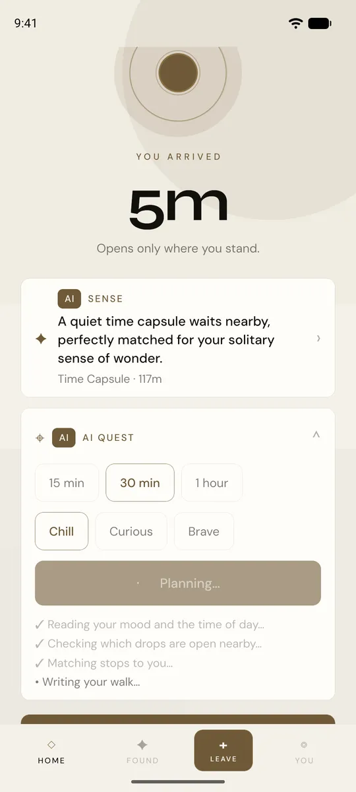<br><sub>Quest Agent: progress while it plans</sub></td>
<td align="center">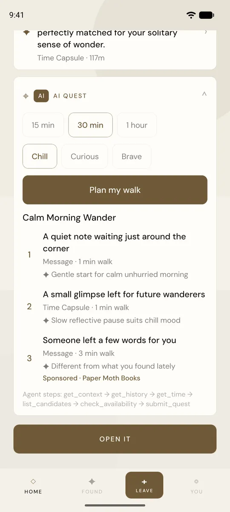<br><sub>Result: three stops, one labelled Sponsored, real tool trace</sub></td>
<td align="center">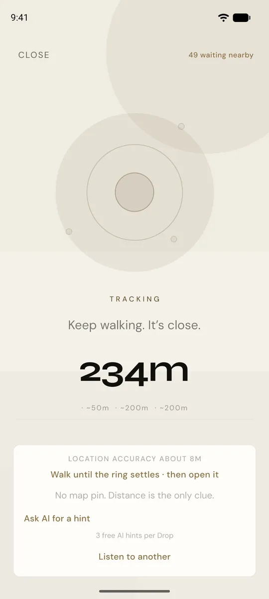<br><sub>Hunt: distance is the only clue</sub></td>
<td align="center">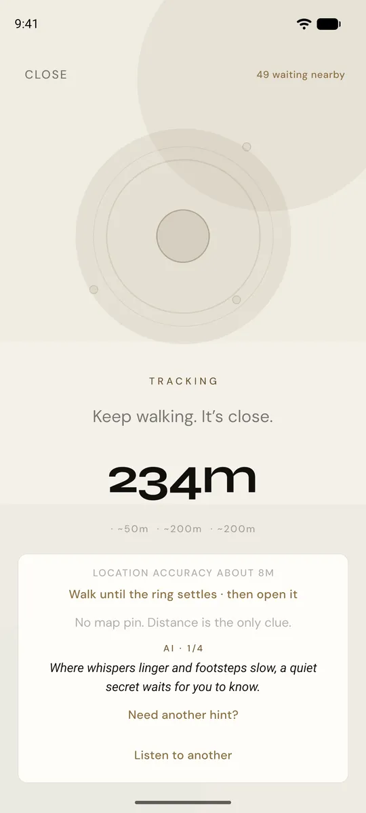<br><sub>Hunt Copilot: an AI riddle hint</sub></td>
</tr>
<tr>
<td align="center">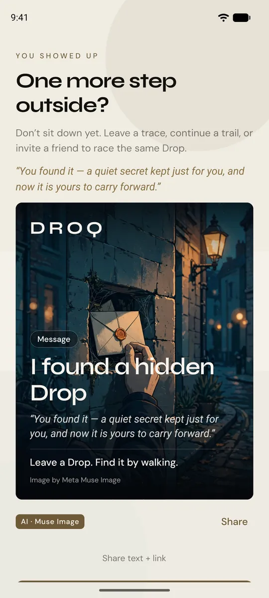<br><sub>Found Epilogue and the branded Found Card</sub></td>
<td align="center">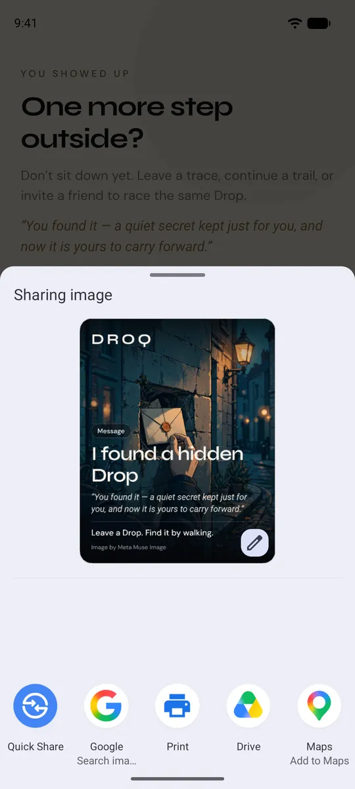<br><sub>Sharing the card as an image</sub></td>
<td align="center">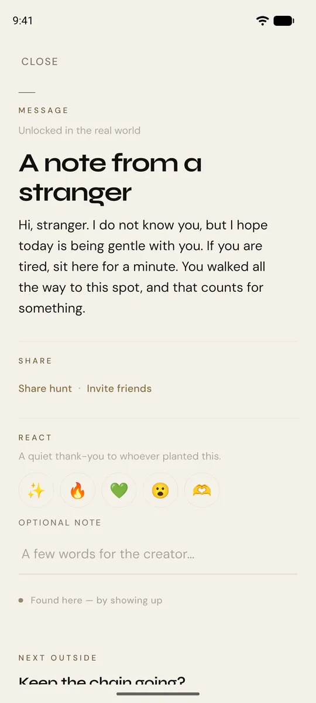<br><sub>The unlocked Drop (demo data)</sub></td>
<td></td>
</tr>
</table>

Owner flow (a business):

<table>
<tr>
<td align="center">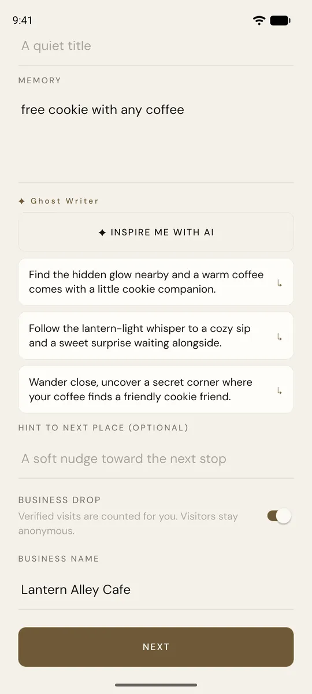<br><sub>Ghost Writer turns an offer idea into three teasers</sub></td>
<td align="center">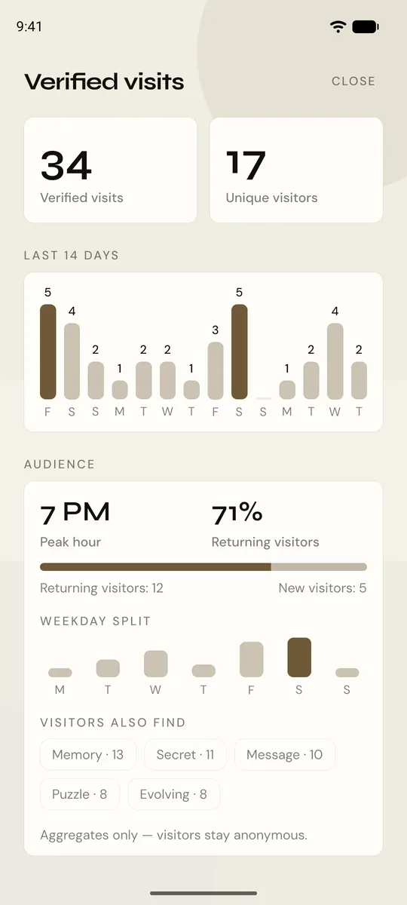<br><sub>Verified visits and audience</sub></td>
<td align="center">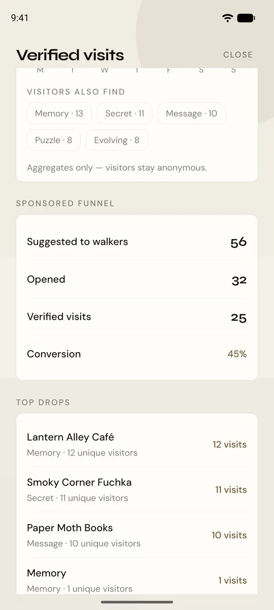<br><sub>Sponsored funnel: suggested, opened, verified</sub></td>
<td align="center">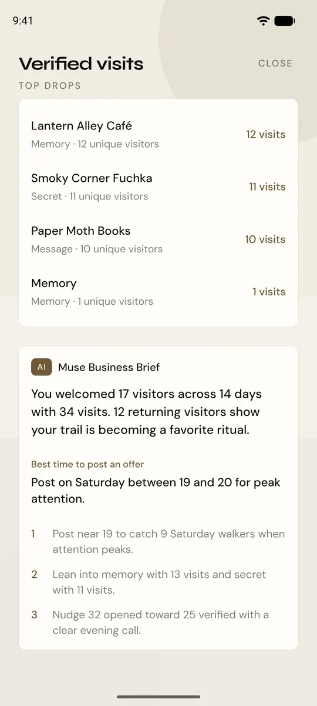<br><sub>Muse Business Brief</sub></td>
<td align="center">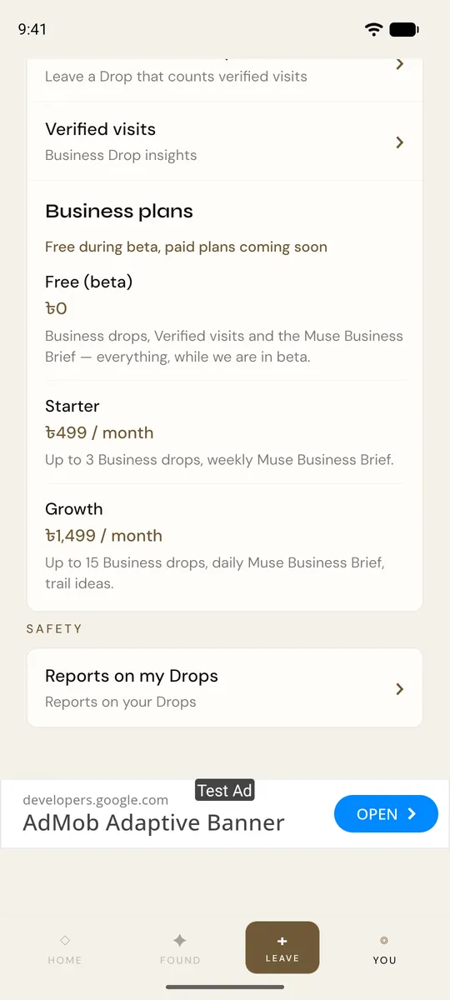<br><sub>Plans card (text only, no billing)</sub></td>
</tr>
</table>

All data in these screenshots is seeded demo data (fictional venues and visitors, see `scripts/demo-seed.sql`).

## Architecture

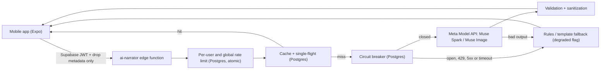

- The model only receives drop metadata (type, walking minutes, a social flag, aggregates). It never sees coordinates or locked content, and output containing coordinates is rejected.
- The server re-validates everything the model returns: drop ids must come from the candidate set, unavailable or time-locked drops are dropped, and at most one stop may be a verified Business drop.
- Every AI feature has a non-AI fallback, so the app keeps working if the model is slow or down.

Production readiness, with measurements:
- Circuit breaker, retry/backoff, single-flight cache, atomic rate limit and call telemetry: [Scaling and resilience](docs/how-it-works.md#scaling-and-resilience).
- Per-action latency, fallback rate, cache hit rate and tokens: [Production telemetry](docs/how-it-works.md#production-telemetry).
- 26-scenario quality and safety eval (schema, no coordinates, no locked-content leaks): [docs/eval-results.md](docs/eval-results.md).
- Step-by-step data flow and exactly what each Muse call sees: [docs/how-it-works.md](docs/how-it-works.md).

## How to evaluate in 5 minutes

1. **Watch the demo video** (3 min): [https://youtu.be/ahecbjdcXBw](https://youtu.be/ahecbjdcXBw).
2. **Read the evidence:** [docs/eval-results.md](docs/eval-results.md) (26/26 scenarios passed, 0 fallbacks in the last run) and the [telemetry table](docs/how-it-works.md#production-telemetry).
3. **Run the unit tests** (verified in this repository: 12 suites, 121 tests pass; `tsc` is clean):
   ```bash
   npm ci
   npm test
   npm run typecheck
   ```
   The Muse calls are not exercised by these tests; the 429/outage paths (`Retry-After`, 5xx backoff, breaker opening, `degraded` flag) are covered by mocked tests in `__tests__/resilience.test.ts`, not live-tested.
4. **Run the AI smoke test and eval against your own Meta Model API key** (needs your own Supabase project, see step 5):
   - Apply the migrations, then set the key as a server-side secret and deploy the function (CLI commands untested by us; the function was deployed through the Supabase dashboard/API):
     ```bash
     supabase secrets set MUSE_API_KEY=<your Meta Model API key>
     supabase functions deploy ai-narrator
     ```
   - Smoke test of the API shape (tool calling, JSON, image): put `MUSE_API_KEY` in your local `.env` and run `node scripts/muse-smoke.mjs`.
   - Eval and load test: `node scripts/muse-eval.mjs` and `node scripts/load-test.mjs`. They read `EXPO_PUBLIC_SUPABASE_URL` and `EXPO_PUBLIC_SUPABASE_ANON_KEY` from `.env`, create throwaway users through public sign-up (turn off "Confirm email" in Supabase Auth) and print the ids to delete afterwards. `muse-eval.mjs` overwrites `docs/eval-results.md`.
   - **Caveat:** these scripts reference the demo drop ids of our own project in `scripts/lib-ai.mjs` (`DEMO_DROPS`). On a fresh project, run `scripts/demo-seed.sql` and replace those ids with the ones it creates before running the eval. We have not run the eval against a second project.
5. **Build the app** (`npx expo run:android`; a development build is required, Expo Go is not enough). Needs your own Supabase project:
   1. Run `supabase/migrations/001_*.sql` through `034_*.sql` in order (SQL editor). `014_dhaka_seed_pack.sql` and `025_bd_nationwide_seed_2k.sql` are optional sample data. Migrations 030 (rate limits), 031 and 033 (Business), 034 (resilience) are the AI/Business ones.
   2. Copy `.env.example` to `.env` and fill the Supabase URL and anon key.
   3. `npm ci`, then `npx expo run:android`.
   4. Optional demo data for the Business screens: edit the owner email at the top of `scripts/demo-seed.sql` and run it; `scripts/demo-remove.sql` removes it.
   5. In a `__DEV__` build, Settings has a GPS simulation (pinned, nearby, approaching, found, time-locked) so you can test unlocking without walking.

## Judging map

| Criterion | Where to look |
| --- | --- |
| **Impact** | Why it matters above; the Business layer (Verified visits, audience, sponsored funnel) in [docs/how-it-works.md](docs/how-it-works.md); owner screens in the gallery. |
| **Use of Meta AI tooling** | The table above: Muse Spark with tool calling (Quest Agent) and Muse Image (Found Card) through the Meta Model API; [`supabase/functions/ai-narrator/index.ts`](supabase/functions/ai-narrator/index.ts). |
| **Technical depth** | Server-verified unlock, DB-backed rate limits and circuit breaker, single-flight cache, server-side validation of model output, deterministic fallbacks: [Scaling and resilience](docs/how-it-works.md#scaling-and-resilience), [eval results](docs/eval-results.md), `__tests__/`, `supabase/migrations/030`-`034`. |
| **Demo** | [Demo video](https://youtu.be/ahecbjdcXBw) and the screenshots above. |

## Honest limitations and roadmap

- **Billing is not built.** The in-app Business plans card is a text-only preview ("Free during beta"); there is no payment flow.
- **Meta AI glasses** are roadmap only; there is no glasses code.
- **Meta 429 and outage handling** is covered by mocked tests, not live-tested: Meta never rate-limited us during testing, and live breaker runs used simulated failures through a test hook.
- **Latency.** Measured against the deployed function (test traffic, small samples): the Quest plan p50 is about 9.7 s (about 4,100 tokens), down from about 13.7 s before trimming; the Business Brief p50 is about 13 s; the Found Card takes about 11-16 s. The app shows progress steps while a plan generates. An earlier load run saw 3 of 8 concurrent briefs fall back; after a fix, a re-run of 8 gave 0 of 8, but it is a small sample.
- **Demo data is seeded.** The numbers in the owner screenshots come from `scripts/demo-seed.sql`, not from real businesses. There is no published per-token price, so we report tokens, not dollars.
- Sharing the Found Card is done on-device only; there is no web page for shared cards.
- The eval and load-test scripts are tied to our project's drop ids (see step 4 above).

## Stack

- **Mobile:** React Native + Expo (SDK 57) + TypeScript + Expo Router
- **Backend:** Supabase (Auth, Postgres, Storage, RLS, Edge Functions)
- **AI:** Meta Model API (Muse Spark, Muse Image), called only from the edge function
- **Location:** native GPS; distance checked on the server (`unlock_drop`), so client GPS alone is not trusted
- **Maps:** none; no map pin is ever shown

## Notes for developers

Core loop: open the app, sense something nearby, walk, watch the distance fall, unlock, experience it, leave a Drop of your own.

Testing the loop with two accounts: the nearby query excludes your own Drops, so create Account A to leave Drops and Account B to find them. Disable "Confirm email" in Supabase Auth while developing so sign-up returns a session immediately.

| Command | Purpose |
| --- | --- |
| `npm start` | Expo dev server |
| `npm test` | Unit tests |
| `npm run typecheck` | TypeScript |
| `node scripts/muse-smoke.mjs` | Check the Meta Model API behaves as the function expects |
| `node scripts/muse-eval.mjs` | 26-scenario quality and safety eval |
| `node scripts/load-test.mjs` | Load and resilience test |

Design notes: the nearby query uses a SQL bounding box (`get_nearby_drops`); photos are compressed on-device and voice is capped at 30 s; exact coordinates are never shown in the UI. The cost posture is Supabase's free tier plus native device APIs, with no paid maps, places or speech services.

## License and contact

MIT, see [LICENSE](LICENSE). Contact: developerimrankhan9@gmail.com (the public support address from the [privacy policy](docs/privacy-policy.md)).
